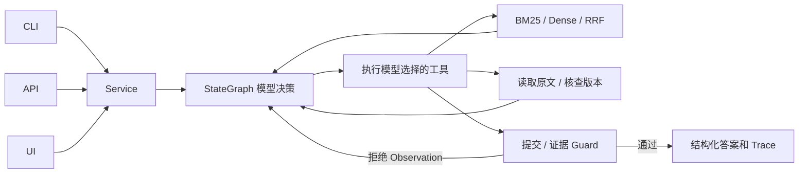

# EvidenceFlow · 题目 3 企业知识问答 Agent

**LangGraph StateGraph + 真实模型 Tool Calling**：模型自行选择检索、读原文、核查版本、补查和结束；程序在模型外强制执行引用校验、冲突边界和循环预算。

实际结果：qwen-plus 官方六项 live **6/6**；32 篇合成制度、44 个固定检索问题（40 个有答案）；Hybrid Recall@3 **0.9875**。最终测试数、阶段及 GitHub 状态以 [最终验收报告](reports/final_acceptance.md) 为准。历史失败和阻塞保留。

已实际创建并推送的私有仓库：[CharlesLTC/evidenceflow-agent](https://github.com/CharlesLTC/evidenceflow-agent)。本次全量与干净环境均通过 63/63 项测试。

## 安装与运行：Windows PowerShell

本机验证 Python 3.12.3，支持 Python >=3.11,<3.14。锁定文件包含实际运行版本及嵌入推理依赖。

```powershell
cd E:\秋招笔试\EvidenceFlow\evidenceflow-agent
python -m venv .venv
.\.venv\Scripts\Activate.ps1
python -m pip install -r requirements.txt
python -m pip install --no-build-isolation --no-deps -e ".[dev,embeddings]"
if (-not (Test-Path .env)) { Copy-Item .env.example .env }
# 在本机 .env 填写 LLM_API_KEY、LLM_BASE_URL、LLM_MODEL_NAME
python -m evidenceflow.cli ask --mode live --question "办公电脑申领审批需要多久？"
python -m evidenceflow.cli ask --mode live --question "差旅报销期限是多久？"
```

也可使用 `py -3.11 -m venv .venv`；无该版本时使用可用的 `python`。若激活脚本受策略限制，直接使用 `.\.venv\Scripts\python.exe`，无需修改系统策略。请保留已有 `.env`，不要用空模板覆盖。

## 模式与追问

- `live` 仅使用真实兼容 Chat Completions/Tool Calling API；本次使用 qwen-plus。缺凭证返回 `FAILED/BLOCKED_LIVE`，不自动回退。
- `mock` 是明确标注的离线 Observation 启发式模拟器；执行实际本地工具和 Guard，只证明流程。
- `fake_model` 仅供测试注入的脚本替身，API 不对外提供；不计入 live。

```powershell
python -m evidenceflow.cli ask --mode mock --question "电脑申领审批多久？"
python -m evidenceflow.cli ask --mode live --session-id demo --question "电脑怎么申领？"
python -m evidenceflow.cli ask --mode live --session-id demo --question "那多久批下来？"
python -m evidenceflow.cli ask --mode live --fail-search-count 1 --question "电脑申领审批多久？"
```

SQLite 保存历史，live/mock 按模式隔离；本轮引用必须重新读取原文。工具故障后的下一步由真实模型选择，无程序自动重试。

## API 与界面

分别在两个已激活环境的终端启动：

```powershell
python -m uvicorn evidenceflow.api:app --host 127.0.0.1 --port 8000
python -m streamlit run ui/app.py --server.address 127.0.0.1 --server.port 8501
```

API 文档：[本机 8000/docs](http://127.0.0.1:8000/docs)；界面：[本机 8501](http://127.0.0.1:8501)。界面经实际 HTTP 读取答案、引用、冲突、Trace、检索排名和实验指标，失败状态不会显示成功。

| 接口 | 用途 |
|---|---|
| `GET /health` | 服务、知识库、凭证配置和嵌入准备状态 |
| `POST /ask` | `question, mode, session_id?, fail_search_count?` |
| `GET /sessions/{id}?mode=live` | 最近十轮会话 |
| `GET /traces/{id}?mode=live` | 实际模型动作与工具 Observation |
| `GET /metrics` | 已落盘的检索、验收和阶段报告 |

模型服务错误返回受控 503 并保留 Trace；业务工具失败可 HTTP 200 返回 `status=FAILED`，调用方必须读取状态字段。服务用于本机合成数据演示，未实施多用户鉴权。

## 验收与复现

```powershell
python -m pytest -q
python -m ruff check src scripts tests ui
python -m pip check
python -m scripts.run_acceptance --mode mock
python -m scripts.run_acceptance --mode live
python -m scripts.validate_live_evidence
python -m scripts.run_extended_live
python -m scripts.smoke_api
python -m scripts.smoke_ui
python -m scripts.verify_artifacts
python -m scripts.check_gate --stage P4
```

pytest 默认不调用外部模型；live 脚本会产生实际 API 用量。成功退出 0，断言失败 1，缺凭证阻塞 2。Codex Windows 沙箱会阻断 asyncio socketpair，本次 API 测试在批准的本机回环环境通过；普通本机终端无此限制。

## 检索实验

```powershell
python -m scripts.download_embeddings
python -m scripts.evaluate_retrieval
python -m scripts.verify_retrieval_results
```

实际多语 MiniLM ONNX 量化模型只保存到被忽略的 `.cache/embeddings`；报告记录 revision、字节数和 SHA256。attention-mask mean pooling + L2 + NumPy cosine。四种策略使用相同语料和标签，保存数据哈希。

| 策略 | Recall@3 | Recall@5 | MRR@5 |
|---|---:|---:|---:|
| A 中文 bigram BM25 | 0.9250 | 0.9375 | 0.9175 |
| B Dense | 0.9750 | 0.9750 | 0.9625 |
| C Hybrid RRF，k=60 | 0.9875 | 1.0000 | 0.9833 |
| D C＋真实模型改写/补查 | 0.9875 | 1.0000 | 0.9833 |

D 没有改善指标，平均模型调用 1.4545 次/题，延迟增加。token 用量已保留；未配置单价，USD 成本为 null，不推测账单。没有分级标注，nDCG=null；资料外问题不进入 Recall/MRR 分母，也不用检索空结果冒充问答拒答率。

默认 Agent 使用可离线运行的 BM25。下载权重后可在 `.env` 设置 `RETRIEVAL_STRATEGY=hybrid` 并重启服务；Dense 不可用时工具返回错误，由模型选择 BM25 或停止。不会用词频向量冒充语义模型。

## 架构和可靠性



仅已读取 chunk 的精确原文可引用；ID、版本、chunk、quote 均由程序核验。回答采用原文摘录和固定状态提示，防止在真实引用旁添加编造断言。D01/D02 的 30/15 天冲突要求两份引用及待确认，较新日期不能裁定优先级。最多 8 次模型决策、12 次工具调用，耗尽返回 INCOMPLETE。

冲突抽取针对合成制度的数值、单位、主题和范围，不能声称解决任意自然语言制度推理。Guard 证明引用确实被读过且来自原文，不证明任意文档真实或任意问题相关性；语义理解仍依赖模型。未做独立人工事实支持率标注，相关指标不填推测值。

## 证据与文档

- [六项 live](reports/acceptance_results.live.json)、[差异路径](reports/live_branch_evidence.json)、[扩展 live](reports/extended_live.json)
- [检索指标](reports/retrieval_metrics.json)、[逐题 CSV](reports/retrieval_details.csv)、[失败案例](reports/retrieval_failures.json)
- [需求](docs/01-requirements.md)、[方案](docs/02-solution.md)、[评估](docs/03-evaluation.md)、[AI 使用](docs/04-ai-usage.md)、[复盘](docs/05-retrospective.md)
- [架构](docs/06-architecture.md)、[测试计划](docs/07-test-plan.md)、[实验](docs/08-experiments.md)、[时间日志](docs/09-time-log.md)

`examples/inputs`、`outputs/{mode}`、`traces/{mode}` 为实际执行材料。早期 live 阻塞尝试没有成功模型决策，不计入达标证据。原始输入哈希在 `reports/input_manifest.json`，规格和 Word 原文文字在 `docs/source`。P7 独立 Critic 为可选项，本次跳过，强制 Guard 保持生效。

实际建仓和首次三方 SHA 核对记录在 `reports/github_delivery.json`。commit 不能将自身 SHA 嵌入自身内容；`python -m scripts.verify_delivery` 核对本地 HEAD、git ls-remote HEAD、GitHub API SHA 和远程 README。本机忽略的 `reports/delivery_verification.local.json` 保存最后实际对照。私有仓库仍需给评审账号授权，本次尚未提供评审账号。

