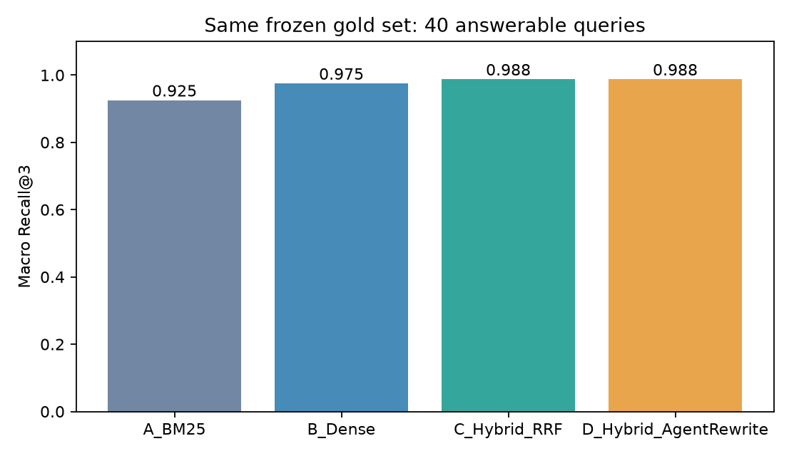
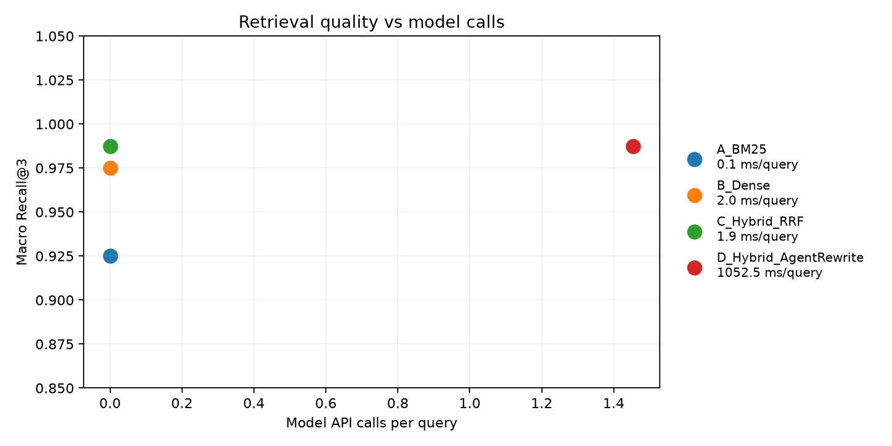

# 检索消融实测

同一固定数据集：32 篇，44 题，40 个有答案。

| 策略 | 状态 | Recall@3 | Recall@5 | MRR@5 | 平均 ms | P95 ms | 平均模型调用 | USD |
|---|---|---:|---:|---:|---:|---:|---:|---:|
| A_BM25 | PASS | 0.9250 | 0.9375 | 0.9175 | 0.136 | 0.171 | 0.0000 | 0.0 |
| B_Dense | PASS | 0.9750 | 0.9750 | 0.9625 | 1.961 | 2.384 | 0.0000 | 0.0 |
| C_Hybrid_RRF | PASS | 0.9875 | 1.0000 | 0.9833 | 1.859 | 2.223 | 0.0000 | 0.0 |
| D_Hybrid_AgentRewrite | PASS | 0.9875 | 1.0000 | 0.9833 | 1052.461 | 1633.647 | 1.4545 | None |

初始化与计时协议：986.9684000004781 ms；CPU; encoder/index initialization excluded and separately timed; uncached query encoding; single query pass, no confidence intervals

A 为中文 bigram BM25；B 为实际多语 MiniLM ONNX 量化嵌入＋cosine；C 为 RRF k=60；D 为真实 qwen-plus 基于候选 Observation 自主改写补查，最多两次。D 未带来指标改善，增加外部调用和延迟，该负面结果不删除。

Recall 为逐题宏平均，报告也提供检出相关文档/总相关文档和每题分子分母；MRR 记录倒数排名和分母。4 个资料外问题不进入这些分母。无分级标注，nDCG=null；检索器不产生问答拒答率。模型单价未知则 USD=null，保留实际 token 用量。

语料与标签在实验前固定并保存 SHA256；不得事后改标签。标注由开发依据合成制度制作，未独立人工复审，单次小样本无置信区间，不代表真实企业分布。

逐题原始结果：reports/retrieval_details.json / CSV；错例：reports/retrieval_failures.json；每题 D 的真实模型 Trace：reports/retrieval_traces/live；模型 revision 和文件哈希：reports/embedding_manifest.json。
